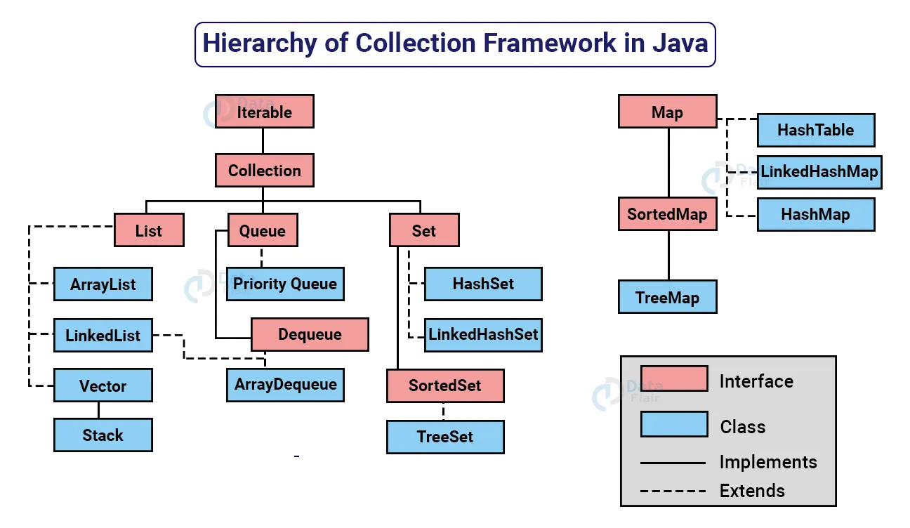

**Java Collection Framework**

The java collection framework provides a set of interfaces and classes to implement various data structures and algorithms. These interfaces includes several methods to perform different operations on collections

For example: The LinkedList class of the collection framework provides the implementation of the doubly linked list data.

**Java Collection Interface**

The collection interface is the root interface of the collections framework heirarchy.

Java does not provide the direct implementation of the Collection interface but provides implementations of its subinterfaces like `List`,`Set` and `Queue  `

**Methods of Collection**

The collection interface includes various methods that can be used to perform different operations on objects. These methods are available in all of its subinterfaces.

